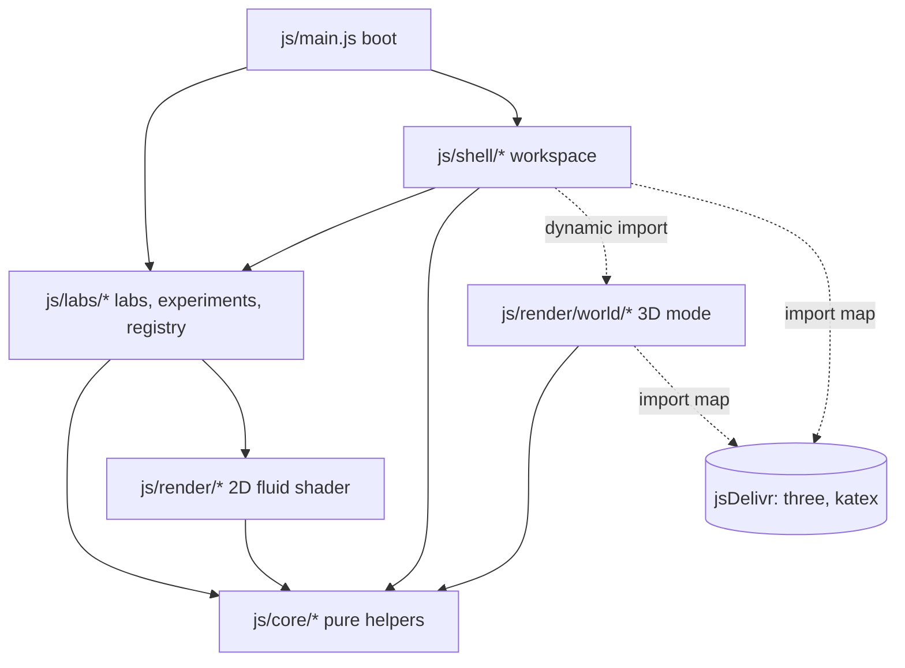
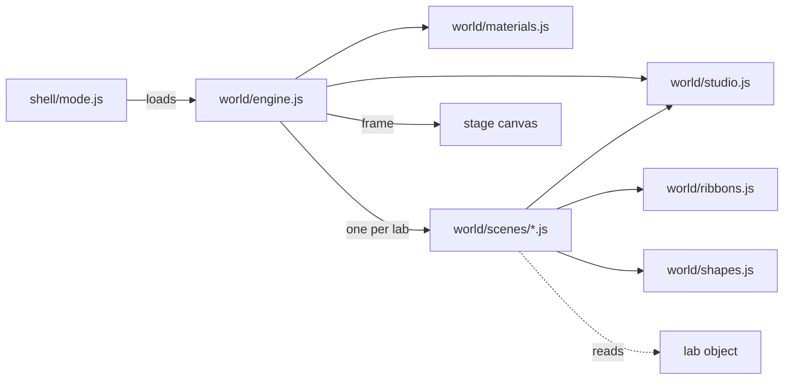

<!--
✒ Metadata
    - Title: Architecture Guide (digiSpace Edition - v2.1)
    - File Name: ARCHITECTURE.md
    - Relative Path: ARCHITECTURE.md
    - Artifact Type: docs
    - Version: 2.1.0
    - Date: 11/06/2026
    - Update: Friday, November 06, 2026
    - Author: Dennis 'dendogg' Smaltz
    - A.I. Acknowledgement: Anthropic - Claude Opus 5.5
    - Signature: ︻デ═─── ✦ ✦ ✦ | Aim Twice, Shoot Once!

✒ Changelog:
    - 2.1.0 (11/06/2026) [dendogg + Anthropic - Claude Opus 5.5] —
      Documented the 3D mode, plane camera, scenes and graphics tiers;
      corrected the claims the audit found false.
    - 2.0.0 (11/05/2026) [dendogg + Anthropic - Claude Opus 5.5] — Created
      for v2.0 on Dennis's direction: documentation for the formal stack.

✒ Description:
    How the modules fit together: layers, boot order, the frame loop, the
    lab contract, 3D views, experiments, capture, styles, and recipes for
    extending the playground.

✒ Key Features:
    - Layer diagram and dependency rules.
    - Required and optional lab hooks in two tables.
    - Recipes for a new lab, icon or third-party library.

✒ Other Important Information:
    - Dependencies: none
    - Compatible platforms: Any Markdown viewer; the layer diagram renders
      where Mermaid is supported
---------
-->
# Architecture

How the playground is put together, and how to extend it without fighting
it. The [README](README.md) covers what the playground does and how to run
it.

## Principles

- **No build step.** The browser loads the same files that sit in the
  repository. Third-party code comes through the import map in
  `index.html`, pinned to exact versions.
- **Labs are data plus behaviour.** Each lab is one plain object that
  implements the lab contract below. The shell never special-cases a lab
  by name; it asks the lab through optional hooks.
- **Rendering is a view of state.** A 3D scene only reads the lab. It holds
  no simulation state, which is why rewind, saved states and scene changes
  need no code in any scene.
- **Modules wire themselves only when asked.** Importing a module may look
  up elements and read saved settings, but attaches nothing. Each shell
  module exports `init()`, and `js/main.js` calls them in one fixed order.
- **State has one owner.** Shared mutable state lives in
  `js/shell/state.js`. Bindings other modules must change (`active`,
  `pointerIsDown`) change only through setters (`setActive`,
  `setPointerDown`).
- **Interfaces tell the truth.** A control that cannot act is disabled and
  says why. A feature that cannot load says so and falls back. Nothing on
  screen claims a state the simulation is not in.

## Layers



| Layer | Folder | Depends on | Holds |
| --- | --- | --- | --- |
| Core | `js/core/` | nothing outside core | DOM helpers, colour ramps, series, chart and sphere drawing, 3D maths, state codec, icon names, KaTeX loader |
| Render | `js/render/` | core | The 2D SPH liquid surface |
| World | `js/render/world/` | core, three.js | The 3D mode: engine, studio, materials, shapes, ribbons, and one scene per lab |
| Labs | `js/labs/` | core, render, a few shell services | One module per lab, the plane camera, the gravity camera, the experiments curriculum, the registry |
| Shell | `js/shell/` | core, labs; loads World on demand | Everything around a lab: panel, tools, camera, input, loop, modes, capture, storage, layout, experiments |

Labs may call shell services that are part of their job: `announce`,
`sticky`, `setParam`, `rebuild`, `syncControl`, `refreshEnabled`,
`updateDock`, `updateNav`, and the camera readers `camOf` and `camXf`.
They never build shell UI themselves.

## Boot order

`js/main.js` imports `js/labs/index.js` first, so every lab object exists
before anything else reads it. Then `boot()` runs:

1. `layout.init` restores focus mode, the bay and the notebook tab.
2. `diagnostics.init`, `transport.init` (buttons and every keyboard
   shortcut), `stage.init` (pointer input), `navigator.init` (gizmo),
   `loop.init` (resize observer), `capture.init`, `workspace.init` (lab
   rail), `mode.init` (2D and 3D, graphics tiers), `automation.init`
   (`window.PhysicsPlayground`).
3. `start()` reads the theme, sizes the stage, applies saved parameters
   and presets, builds the orbit ball and library controls, selects the
   lab from the address hash or the last visit, starts the frame loop and
   finally opens storage.

## The frame loop

`js/shell/loop.js` runs one `requestAnimationFrame` loop for the active
lab:

- **Simulation**: an accumulator feeds `lab.step(lab.dt())` in fixed steps,
  capped by `lab.maxSteps` and by a frame-time budget, then calls
  `lab.after(simulatedSeconds)`.
- **Drawing**: in 2D, `drawStage` applies the camera and calls `lab.draw`.
  In 3D, `drawWorld` renders the lab's scene and composites it into the
  stage canvas, then calls `lab.overlay3`, so video capture and pointer input
  work the same in both modes.
- **Rates**: HUD and gizmo every 0.1 s; readouts, chart, capture chips and
  the experiment check every 0.25 s; diagnostics every 0.5 s.

## The lab contract

A lab is an object registered in `js/labs/index.js`. The registry adds
`t`, `size`, `ready`, `sceneP` and `experiments` to it.

### Required

| Member | Purpose |
| --- | --- |
| `id`, `name`, `title`, `aria` | Identity, rail label, scene heading, stage label for screen readers |
| `eq`, `eqTex` | Equation for the rail (HTML) and the Scene tile (TeX) |
| `blurb`, `interact[]` | Guide page text: what the lab shows and how to interact |
| `p`, `presetId`, `presets[]` | Parameters, the current scene, and scenes as `{ id, label, params }` |
| `controls[]` | `range`, `seg` and `toggle` controls bound to keys of `p` |
| `dt()`, `maxSteps` | Fixed time step and the per-frame step cap |
| `build(presetId, w, h)` | Create the scene for a stage of size w × h |
| `step(dt)` | Advance one fixed step |
| `draw(g, w, h)` | Draw onto the stage 2D context |
| `readouts()` | Rows of `[label, value, state?]`, with state `ok`, `warn`, `crit` or `idle` |
| `chart` | `{ title, caption, draw(c) }`, or `null` for no chart |
| `math` | HTML for the Math page; `[data-tex]` elements are typeset with KaTeX |

### Optional hooks

| Hook | Purpose |
| --- | --- |
| `dock`, `pointerDown`, `pointerMove`, `pointerUp`, `pointerCancel`, `cursorAt` | Tools on the stage; points arrive in world units unless `screenInput` is set, in 3D through a ray onto the simulation plane. `pointerCancel` drops the gesture without committing it |
| `rig3`, `tilt3()`, `overlay3(g, w, h)` | Where the plane stands in 3D, its angle if it moves, and screen overlays drawn after the frame |
| `zoomRange` | `[lo, hi]` zoom limits for the 2D camera |
| `actions[]` | Buttons under the parameters |
| `enabled(key)` | `true`, or a sentence saying why a control is disabled right now |
| `onParam(key, value)`, `onResize(w, h, ow, oh)`, `after(simDt)` | React to changes |
| `worldRect()`, `mini(g, k)`, `unit()` | Camera world size, overview map, scale bar units |
| `selfCam`, `camLocked()`, `onUserPan()`, `onCamZoom()`, `frameView()`, `navExtras[]` | Labs with their own camera (gravity) and extra gizmo buttons |
| `diagnose()`, `perfFixes()`, `drawFixes()`, `sane()`, `watchDraw(perf)` | Insights with fixes, frame-budget and drawing fixes, a NaN guard, and a twice-a-second look at drawing cost |
| `snapshot()`, `restore(s)`, `histBudget`, `histInterval` | Rewind history |
| `serialize()`, `deserialize(o)` | Saved states (`genericState` from `core/codec.js` derives them from snapshot and restore) |
| `dataColumns[]`, `dataRow()`, `trackColumns[]`, `trackRows(out)`, `trackLabel` | Datasets and per-object tracks; the first column is always simulated time |
| `stateSummary()` | Extra fields shown on a saved state in the Library |

## The 3D mode

`js/shell/mode.js` owns the workspace's two modes and the graphics tier. 2D
is each lab's own `draw`. 3D is `js/render/world/`, which loads on demand: the
first use imports three.js and builds one engine, and each lab's scene module
loads the first time that lab is shown.



### The plane camera

A lab that simulates on a plane declares where the plane stands with `rig3`,
and `js/labs/stage3d.js` is mixed in by the registry to give it the camera
hooks the shell calls: `c3()`, `basis3()`, `pick3(screenPoint)`,
`orbit3(dx, dy)`, `pan3(dx, dy)`, `zoom3(f, screenPoint, instant)`, `frame3()`,
`actual3()`, `zoomPct3()`, `snap3(axisId)` and `tick3(realSeconds)`.

The long side of every world is 10 scene units, so lights and materials read
the same in every lab at every window size. `plane3()` maps world (x, y) into
the scene: a `floor`, a `wall`, or any angle from `tilt3()`. `pick3` is a ray
and plane intersection, so a click lands in the lab's own world coordinates
and pointer tools need no 3D code. `project3` goes the other way for
overlays.

Gravity is really three-dimensional, so it keeps its own camera in
`js/labs/gravity3d.js` with the same hooks.

### A scene

`js/render/world/scenes/<id>.js` exports `createScene(E, lab)` and returns:

| Member | Purpose |
| --- | --- |
| `scene`, `studio` | The three.js scene and, usually, the studio it stands in |
| `sync(lab, view)` | Every frame: copy lab state into objects, reading only |
| `prepare(renderer, camera)` | Extra GPU passes before the main render |
| `onTier(tier, w, h)` | Resize targets and thin meshes for a new tier |
| `exposure`, `bloom` | Per-scene grade |
| `dispose()` | Free what it made |

The studio is the room: softboxes baked into image-based light, a shadowed
key, a polished floor with a planar reflection, and a backdrop the floor
dissolves into. Rim light lives in the softboxes rather than in lights, so it
edges the apparatus without a streak across the floor.

### Graphics tiers

`js/core/tiers.js` holds the ladder and the device probe, and needs no
three.js, so the shell can show the choice first. A tier sets resolution,
MSAA, shadow size, the reflection's share of resolution, bloom, grade and a
`detail` scale that scenes use to thin their own meshes. `tickWorld` runs the
Auto mode from the frame loop: three-second windows, a step down above 25 ms
per frame, a step up after twelve seconds under 17.6 ms. A step down that does
not improve the frame time by 8% is undone and adapting stops, because the
limit is then the solver or the display.

### When 3D cannot run

A failed three.js import or missing WebGL 2 keeps the workspace in 2D, disables
the 3D switch with the reason and adds an insight. A lost WebGL context drops
to 2D and returns when the context does. A scene that throws sends only its
own lab back to 2D. The simulation never notices any of this.

## Guided experiments

`js/labs/experiments.js` holds the curriculum, keyed by lab id:

```js
{
  id: 'drift', title: 'Same drift for every charge', scene: 'exb',
  goal: 'In crossed fields every particle drifts at E/B …',
  steps: ['Run the crossed-field scene for two cyclotron periods.', '…'],
  init(lab) { return { time: 0 }; },               // per-run memory
  check(lab, ctx, dt) { return { p: 0.4, note: '…' }; }, // progress 0–1 and a reading
}
```

`js/shell/experiments.js` runs one experiment at a time. Starting one
loads its scene. The check runs four times a second with the simulated
seconds since the last check. A reset re-runs `init`; leaving the scene
pauses progress; reaching `p = 1` marks the experiment finished in local
storage. Checks read lab state directly, never the formatted readouts.

## Capture and storage

`js/shell/capture.js` keeps the rewind history (snapshots every
`histInterval` seconds within `histBudget` bytes), records WebM clips of
the stage canvas, samples datasets at a fixed rate, and saves states.
`js/shell/vault.js` stores them: artifact storage when the page runs as a
published artifact, IndexedDB in a plain browser, memory as a last resort.
`js/shell/library.js` lists them in the notebook.

## Styles

The stylesheets load in this order, each building on the last:

| File | Holds |
| --- | --- |
| `tokens.css` | Colours, type, spacing, radius, the page grid |
| `icons.css` | Material Symbols styling and tab glyph animations |
| `workspace.css` | Top bar, lab rail, bento grid, tile chrome, keys sheet |
| `controls.css` | Buttons, segmented choices, sliders, switches |
| `stage.css` | Stage header, HUD, experiment banner, gizmo, timeline |
| `tiles.css` | Scene, tools, chart, readouts, diagnostics, notebook |
| `library.css` | Library page |
| `responsive.css` | Reflow and rail compaction for narrow screens |

Tiles are inline-size containers, so their contents adapt with container
queries to the tile's width, not the window's. Grid tracks use `minmax(0, …)` and
the body grid is pinned to the viewport width, so no content can resize
the stage.

## Recipes

### Add a lab

1. Create `js/labs/<id>.js` exporting the lab object (start from
   `fields.js`, the newest and most complete example). Give it a `rig3`.
2. Register it in `js/labs/index.js`; its position sets its number key.
   Create `js/render/world/scenes/<id>.js` and add it to `LOADERS` in
   `js/render/world/engine.js`.
3. Add its glyph to `LAB_ICON` in `js/core/icons.js`, its tool glyphs to
   `ICON`, and any new glyph names to `icon_names` in `index.html`
   (sorted).
4. Declare its zoom range on the lab object, `zoomRange: [lo, hi]`, unless
   the default of 0.5× to 8× suits it.
5. Add its experiments under its id in `js/labs/experiments.js`.
6. Run `npm run verify` and `npm test`.

### Add an icon

Name it once in `js/core/icons.js` (or write it into markup with the `ms`
class), add it to the sorted `icon_names` list in the Material Symbols
link in `index.html`, and run `npm run check`. The checker fails if a
glyph the code uses is missing from the font subset.

### Add or upgrade a third-party library

Pin the exact version in the import map in `index.html`, record it in
`vendor/VENDOR.md`, and load it with a dynamic `import()` where it is not
needed at start-up. Stylesheets and fonts must come from Google Fonts or
the project itself (the artifact host's content policy), so vendor them
under `vendor/`.

## Conventions

- Every project file starts with the digiSpace ✒ header.
  Browser-delivered files keep at most three changelog entries in 40
  lines; the full history is in [CHANGELOG.md](CHANGELOG.md).
- Dates are written MM/DD/YYYY.
- `npm run verify` and `npm test` pass before a release.

<!-- ︻デ═─── ✦ ✦ ✦ | Aim Twice, Shoot Once! -->
