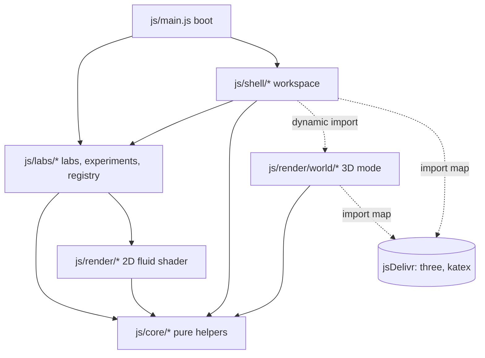
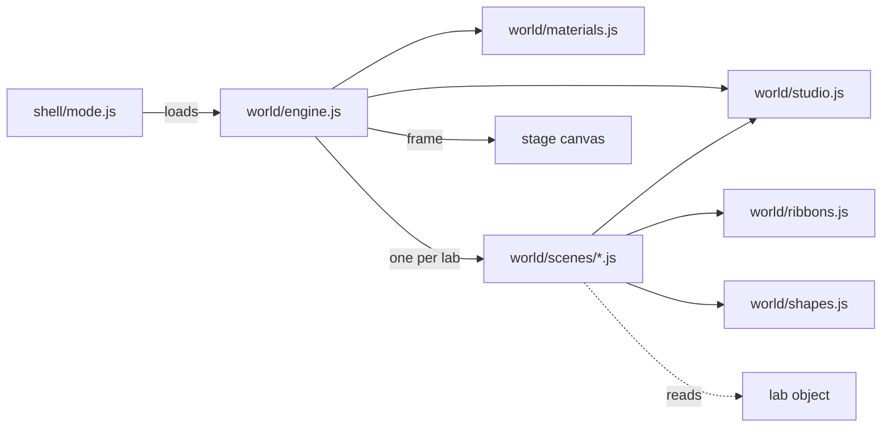
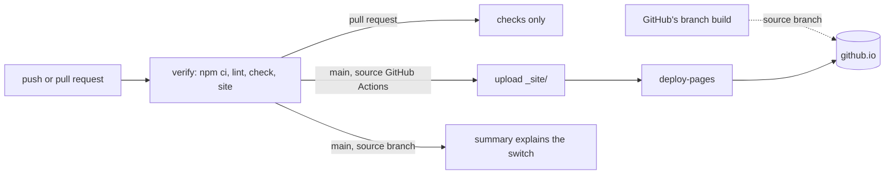

<!--
✒ Metadata
    - Title: Architecture Guide (digiSpace Edition - v2.11)
    - File Name: ARCHITECTURE.md
    - Relative Path: ARCHITECTURE.md
    - Artifact Type: docs
    - Version: 2.11.0
    - Date: 11/14/2026
    - Update: Saturday, November 14, 2026
    - Author: Dennis 'dendogg' Smaltz
    - A.I. Acknowledgement: Anthropic - Claude Opus 5.5
    - Signature: ︻デ═─── ✦ ✦ ✦ | Aim Twice, Shoot Once!

✒ Changelog:
    - 2.11.0 (11/14/2026) [dendogg + Anthropic - Claude Opus 5.5] — The dials'
      anatomy (text(), the parted ridges, the keyboard-only ring, the wheel as
      the field) and their grid of equal cells on a subgrid; the Math page's
      dials in equal cells.
    - 2.10.0 (11/14/2026) [dendogg + Anthropic - Claude Opus 5.5] — orbitFrame
      and orbitCurve, the fading orbits in 2D and 3D, depth marks and merge
      flashes in the Solar System section; the zoomPace and zoomLimits3 hooks.
    - 2.9.0 (11/14/2026) [dendogg + Anthropic - Claude Opus 5.5] — Gravity's
      planet classes: KINDS and its fields, kindOf, mergedKind, storedKind,
      the coupled controls, planetRadius, physique and Inspect's Hill, Roche
      and IAU rows; Random placement draws classes.
    - 2.8.0 (11/10/2026) [dendogg + Anthropic - Claude Opus 5.5] — Gravity's
      Solar System: its section (body metadata, sources and test bodies, moon
      substeps, the sky frame, drawing to scale, orbits and names), its data
      module in the layers, the date on its clock, and log-scale quantities in
      significant figures.
    - 2.7.0 (11/10/2026) [dendogg + Anthropic - Claude Opus 5.5] — The head-up
      display: its section, the lab hooks hud and hudTarget, the camera reader
      toScreen, its place in the boot order, frame loop and styles, and the
      convention that anything over the stage that changes keeps its own
      compositor layer and opacity, with the measurements behind it.
    - 2.6.0 (11/10/2026) [dendogg + Anthropic - Claude Opus 5.5] — Live Math
      checks: the scale for a theory that can be zero, and the three rules
      every check keeps (its theory never comes from the measurement beside
      it, it is for the law the run uses, and it says when its formula does
      not apply).
    - 2.5.0 (11/10/2026) [dendogg + Anthropic - Claude Opus 5.5] — Adds Live
      Math (mathLive and data-live), the Guide and the Library's capture
      cards, Inspect's history and focus, and the page's grain, light and
      glass tokens. Then, on Dennis's further call, the thumbwheel dials that
      replace the sliders (dial.js), random placement (the random capability,
      the rail's dice and planet types) and a note on why the glass is drawn
      without a blur. A convention keeps tiles and repainting cards cheap to
      draw.
    - 2.4.0 (11/10/2026) [dendogg + Anthropic - Claude Opus 5.5] — Adds the
      interaction model (each region's job and the capabilities it reads), the
      deck and Inspect, and the unit systems; the lab contract gains views,
      units, unitTable, scaleNote, timeNote, inspectHint, short and primary.
    - 2.3.0 (11/09/2026) [dendogg + Anthropic - Claude Opus 5.5] —
      Documented control sections (groups, group and short), the keep()
      hook and restart(), the Controls page, and the Chaos phase view.
    - 2.2.0 (11/09/2026) [dendogg + Anthropic - Claude Opus 5.5] — Added
      the Deployment section for the GitHub Pages pipeline Dennis asked to
      harden, recipes for the README pictures and new CDN hosts, the
      colophon in the styles table, and a navigation line shared with the
      other documents.
    - 2.1.0 (11/06/2026) [dendogg + Anthropic - Claude Opus 5.5] —
      Documented the 3D mode, plane camera, scenes and graphics tiers;
      corrected the claims the audit found false.
    - 2.0.0 (11/05/2026) [dendogg + Anthropic - Claude Opus 5.5] — Created
      for v2.0 on Dennis's direction: documentation for the formal stack.

✒ Description:
    How the modules fit together: layers, boot order, the frame loop, the
    lab contract, 3D views, experiments, capture, styles, deployment, and
    recipes for extending the playground.

✒ Key Features:
    - Layer diagram and dependency rules.
    - Required and optional lab hooks in two tables.
    - The GitHub Pages pipeline: what is staged, what is checked, and
      which Pages source deploys.
    - Recipes for a new lab, icon, third-party library or README picture.

✒ Other Important Information:
    - Dependencies: none
    - Compatible platforms: Any Markdown viewer; the layer diagram renders
      where Mermaid is supported
---------
-->
# Architecture

[README](README.md) ✦ **Architecture** ✦ [Changelog](CHANGELOG.md) ✦
[Third-party](vendor/VENDOR.md) ✦ [Live lab](https://dnoice.github.io/physics-playground/)

How the playground is put together, and how to extend it without fighting
it. The [README](README.md) covers what the playground does and how to run
it.

## Principles

- **No build step.** The browser loads the same files that sit in the
  repository. Third-party code comes through the import map in
  `index.html`, pinned to exact versions.
- **Labs are data plus behaviour.** Each lab is one plain object that
  implements the lab contract below. The shell never special-cases a lab
  by name; it asks the lab through optional hooks.
- **Rendering is a view of state.** A 3D scene only reads the lab. It holds
  no simulation state, which is why rewind, saved states and scene changes
  need no code in any scene.
- **Modules wire themselves only when asked.** Importing a module may look
  up elements and read saved settings, but attaches nothing. Each shell
  module exports `init()`, and `js/main.js` calls them in one fixed order.
- **State has one owner.** Shared mutable state lives in
  `js/shell/state.js`. Bindings other modules must change (`active`,
  `pointerIsDown`) change only through setters (`setActive`,
  `setPointerDown`).
- **Interfaces tell the truth.** A control that cannot act is disabled and
  says why. A feature that cannot load says so and falls back. Nothing on
  screen claims a state the simulation is not in.

## Layers



| Layer | Folder | Depends on | Holds |
| --- | --- | --- | --- |
| Core | `js/core/` | nothing outside core | DOM helpers, colour ramps, series, chart and sphere drawing, 3D maths, state codec, icon names, KaTeX loader, unit systems |
| Render | `js/render/` | core | The 2D SPH liquid surface |
| World | `js/render/world/` | core, three.js | The 3D mode: engine, studio, materials, shapes, ribbons, and one scene per lab |
| Labs | `js/labs/` | core, render, a few shell services | One module per lab, the plane camera, the gravity camera, the Solar System's data (`solarsystem.js`), the experiments curriculum, the registry |
| Shell | `js/shell/` | core, labs; loads World on demand | Everything around a lab: panel and its dials, rail (tools, Random and views), camera, input, loop, modes, deck (instruments, inspect, insights), head-up display, live math, guide, units menu, capture, storage, layout, experiments |

Labs may call shell services that are part of their job: `announce`,
`sticky`, `setParam`, `rebuild`, `restart`, `syncControl`, `refreshEnabled`,
`updateDock`, `updateNav`, and the camera readers `camOf`, `camXf` and
`toScreen`.
They never build shell UI themselves.

## Boot order

`js/main.js` imports `js/labs/index.js` first, so every lab object exists
before anything else reads it. Then `boot()` runs:

1. `layout.init` restores focus mode, the bay and the notebook tab.
2. `diagnostics.init`, `transport.init` (buttons and every keyboard
   shortcut), `stage.init` (pointer input), `navigator.init` (gizmo),
   `loop.init` (resize observer), `capture.init`, `workspace.init` (lab
   rail), `mode.init` (2D and 3D, graphics tiers), `instruments.init`
   (scope), `deck.init` (panes, sizes and grip), `details.init` (Inspect
   card), `unitmenu.init` (Units menu), `headsup.init` (the head-up
   display's menu and its remembered settings), `automation.init`
   (`window.PhysicsPlayground`).
3. `start()` reads the theme, sizes the stage, applies saved parameters
   and presets, builds the orbit ball and library controls, selects the
   lab from the address hash or the last visit, starts the frame loop and
   finally opens storage.

## The frame loop

`js/shell/loop.js` runs one `requestAnimationFrame` loop for the active
lab:

- **Simulation**: an accumulator feeds `lab.step(lab.dt())` in fixed steps,
  capped by `lab.maxSteps` and by a frame-time budget, then calls
  `lab.after(simulatedSeconds)`.
- **Drawing**: in 2D, `drawStage` applies the camera and calls `lab.draw`.
  In 3D, `drawWorld` renders the lab's scene and composites it into the
  stage canvas, then calls `lab.overlay3`, so video capture and pointer input
  work the same in both modes. After either, `trackHud` places the head-up
  display's target box on the selected object as it was just drawn.
- **Rates**: the status chips (time, rate, frame rate) and gizmo every 0.1 s;
  readouts, chart, capture chips, the head-up display's tape and callout, and
  the experiment check every 0.25 s; diagnostics and the caution lights every
  0.5 s.

## The lab contract

A lab is an object registered in `js/labs/index.js`. The registry adds
`t`, `size`, `ready`, `sceneP` and `experiments` to it.

### Required

| Member | Purpose |
| --- | --- |
| `id`, `name`, `title`, `aria` | Identity, rail label, scene heading, stage label for screen readers |
| `eq`, `eqTex` | Equation for the rail (HTML) and the Scene tile (TeX) |
| `blurb`, `interact[]` | Guide page text: what the lab shows and how to interact |
| `p`, `presetId`, `presets[]` | Parameters, the current scene, and scenes as `{ id, label, params }` |
| `controls[]` | `range`, `seg` and `toggle` controls bound to keys of `p`; each names its section with `group`, and a switch may add a `short` name |
| `dt()`, `maxSteps` | Fixed time step and the per-frame step cap |
| `build(presetId, w, h)` | Create the scene for a stage of size w × h |
| `step(dt)` | Advance one fixed step |
| `draw(g, w, h)` | Draw onto the stage 2D context |
| `readouts()` | Rows of `[label, value, state?]`, with state `ok`, `warn`, `crit` or `idle` |
| `chart` | `{ title, caption, draw(c) }`, or `null` for no chart |
| `math` | HTML for the Math page; `[data-tex]` elements are typeset with KaTeX |

### Optional hooks

| Hook | Purpose |
| --- | --- |
| `dock`, `pointerDown`, `pointerMove`, `pointerUp`, `pointerCancel`, `cursorAt` | Tools on the stage; points arrive in world units unless `screenInput` is set, in 3D through a ray onto the simulation plane. `pointerCancel` drops the gesture without committing it |
| `views` | View modes as `{ key, label, options: [{ id, label, icon, tip, hint }] }`, shown as the rail's View group; a view changes only what is drawn (Chaos, Waves) |
| `rig3`, `tilt3()`, `overlay3(g, w, h)` | Where the plane stands in 3D, its angle if it moves, and screen overlays drawn after the frame |
| `zoomRange` | `[lo, hi]` zoom limits for the 2D camera |
| `groups[]` | The Controls page's sections in order, as `{ id, label, icon }`; a lab without them gets one section |
| `actions[]` | Quick actions, shown first on the Controls page |
| `keep()` | The user's edits to the world that a parameter-driven rebuild should carry over; `build()` reads them back from `lab.kept` (Fluid's posts) |
| `enabled(key)` | `true`, or a sentence saying why a control is disabled right now |
| `onParam(key, value)`, `onResize(w, h, ow, oh)`, `after(simDt)` | React to changes |
| `worldRect()`, `mini(g, k)`, `unit()` | Camera world size, overview map, and the lab's own length per stage pixel for the scale bar |
| `units`, `unitTable(sys)`, `scaleNote`, `timeNote(t)` | Real-world units: `units = { len, m }` names the lab's length unit and its size in metres; `unitTable` replaces the conversions outright (Gravity's AU and km/s); `scaleNote` explains the scale in the Units menu; `timeNote` adds to the HUD clock |
| `selfCam`, `camLocked()`, `onUserPan()`, `onCamZoom()`, `frameView()`, `navExtras[]` | Labs with their own camera (gravity) and extra gizmo buttons |
| `zoomPace()`, `zoomLimits3()` | How strongly the user's zoom controls act (the wheel, the rail's buttons and drag, the keys raise their factor to this power; Gravity's Solar System, eight decades of scale, returns 2), and Gravity's 3D zoom limits as multiples of the framing distance. Pinch and scripted zooms keep their exact factor |
| `diagnose()`, `perfFixes()`, `drawFixes()`, `sane()`, `watchDraw(perf)` | Insights with fixes, frame-budget and drawing fixes, a NaN guard, and a twice-a-second look at drawing cost |
| `snapshot()`, `restore(s)`, `histBudget`, `histInterval` | Rewind history |
| `serialize()`, `deserialize(o)` | Saved states (`genericState` from `core/codec.js` derives them from snapshot and restore) |
| `dataColumns[]`, `dataRow()`, `trackColumns[]`, `trackRows(out)`, `trackLabel` | Datasets and per-object tracks; the first column is always simulated time |
| `stateSummary()` | Extra fields shown on a saved state in the Library |
| `inspect()`, `deselect()`, `inspectHint` | The selected object for the Inspect pane, or null: `{ id, kicker, short, title, color or rgb, rows, actions, spot, focus }`, where `short` names the object in plotted series, `spot` asks the scene for a portrait and `focus` names the figure the focus chart follows first; `inspectHint` tells an empty pane how to select in this lab |
| `random` | Random placement: `{ key, label, tip }`, naming a boolean parameter (by convention `rand`) that the lab's placing tools read. The shell shows a dice under the tools, a Random card in the Guide, and the lab adds the matching switch to its controls |
| `mathLive` | The Math page's live panels, keyed by the `data-live` name of a formula in `math`: `{ params, vars(lab), check(lab), plot(c, lab), plotLabel, note }` (see Live Math below) |
| `primary` | The primary readouts, which lead with larger figures: a list of labels, or a count of leading rows (default 2). A readout row may also end with its tier, `'primary'` or `'derived'` |
| `hudClear` | Boxes in stage pixels (`{ l, t, r, b }`) of what the lab drew this frame and the head-up display's callout should keep off, such as Gravity's names beside bodies; the callout counts covering one as it counts covering the tape |
| `hud`, `hudTarget(three)` | The head-up display: `hud` lists the readouts its tape carries as `[label, short name]` pairs (default: the primary readouts under their own names); `hudTarget` returns the inspected object's `{ x, y, r }` in stage pixels for the current mode, or null, so the target box sits on it as drawn (see Head-up display below) |

## The 3D mode

`js/shell/mode.js` owns the workspace's two modes and the graphics tier. 2D
is each lab's own `draw`. 3D is `js/render/world/`, which loads on demand: the
first use imports three.js and builds one engine, and each lab's scene module
loads the first time that lab is shown.



### The plane camera

A lab that simulates on a plane declares where the plane stands with `rig3`,
and `js/labs/stage3d.js` is mixed in by the registry to give it the camera
hooks the shell calls: `c3()`, `basis3()`, `pick3(screenPoint)`,
`orbit3(dx, dy)`, `pan3(dx, dy)`, `zoom3(f, screenPoint, instant)`, `frame3()`,
`actual3()`, `zoomPct3()`, `snap3(axisId)` and `tick3(realSeconds)`.

The long side of every world is 10 scene units, so lights and materials read
the same in every lab at every window size. `plane3()` maps world (x, y) into
the scene: a `floor`, a `wall`, or any angle from `tilt3()`. `pick3` is a ray
and plane intersection, so a click lands in the lab's own world coordinates
and pointer tools need no 3D code. `project3` goes the other way for
overlays.

Gravity is really three-dimensional, so it keeps its own camera in
`js/labs/gravity3d.js` with the same hooks.

### A scene

`js/render/world/scenes/<id>.js` exports `createScene(E, lab)` and returns:

| Member | Purpose |
| --- | --- |
| `scene`, `studio` | The three.js scene and, usually, the studio it stands in |
| `sync(lab, view)` | Every frame: copy lab state into objects, reading only |
| `prepare(renderer, camera)` | Extra GPU passes before the main render |
| `onTier(tier, w, h)` | Resize targets and thin meshes for a new tier |
| `portrait(lab)` | The camera for the Inspect card's portrait, and optionally its own small scene |
| `exposure`, `bloom` | Per-scene grade |
| `dispose()` | Free what it made |

The studio is the room: softboxes baked into image-based light, a shadowed
key, a polished floor with a planar reflection, and a backdrop the floor
dissolves into. Rim light lives in the softboxes rather than in lights, so it
edges the apparatus without a streak across the floor.

A scene can reuse the lab's own 2D drawing instead of rebuilding it in
three.js. The Chaos phase view paints `drawPhase` onto a screen whose face
lies exactly over the map's world rectangle on the simulation plane, so
`pick3` lands clicks and the hover preview on the same angles as in 2D, and
the scene needs no picking code of its own.

### Graphics tiers

`js/core/tiers.js` holds the ladder and the device probe, and needs no
three.js, so the shell can show the choice first. A tier sets resolution,
MSAA, shadow size, the reflection's share of resolution, bloom, grade and a
`detail` scale that scenes use to thin their own meshes. `tickWorld` runs the
Auto mode from the frame loop: three-second windows, a step down above 25 ms
per frame, a step up after twelve seconds under 17.6 ms. A step down that does
not improve the frame time by 8% is undone and adapting stops, because the
limit is then the solver or the display.

### When 3D cannot run

A failed three.js import or missing WebGL 2 keeps the workspace in 2D, disables
the 3D switch with the reason and adds an insight. A lost WebGL context drops
to 2D and returns when the context does. A scene that throws sends only its
own lab back to 2D. The simulation never notices any of this.

## Controls and rebuilds

`js/shell/panel.js` builds the Controls page from the lab: its quick actions
first, then one section per entry in `groups`, each holding the controls
whose `group` names it, numbers and choices first and switches in a grid
below. A number is a thumbwheel dial (`js/shell/dial.js`): a ridged wheel
with the value in its middle and its unit set back (`text()`), chevrons at
its ends and a hairline along its foot for the range with the scene's mark.
The wheel is the only box: the ridges part round the value at its measured
width and come up under the pointer and with focus. Consecutive dials share
an open grid of equal cells; each cell puts its name, wheel and note on rows
it shares with the cells beside it (a CSS subgrid), so a row's wheels line
up past a two-line name or a note. The focus ring shows for the keyboard
only, and while a value is typed the wheel itself is the field. A native
range input lies under each wheel, invisible and
untouchable, and stays the single source of truth: it takes focus and the
arrow keys and tells screen readers the value, and the wheel only sets its
value and fires its `input` events. A drag, a nudge or a burst of wheel
scrolling ends with one `change`, and only if the value moved, so a control
with `rebuild: true` restarts the run once per gesture. The mouse wheel turns
a dial only once it has focus, so scrolling the page past one never changes a
setting. A section folds (remembered per lab), shows **Reset** while any of its
values differs from the scene's, and carries one "Changes here restart the
run" note when a control in it has `rebuild`. Untagged controls land in a
closing "More" section, so a control can never go missing.

A change to a control with `rebuild` restarts the run through
`rebuild(lab)`, which keeps the user's edits: the lab's `keep()` hands them
to `build()` as `lab.kept`, so Fluid's posts outlast a change of Particles.
Loading a scene, Reset, recovering from a blown-up run and loading a saved
state call `restart(lab)` instead, which rebuilds from the scene as written.

## Interaction model

Each region of the workspace has one job, and a lab declares capabilities
rather than building interface.

| Region | Responsibility | Lab capabilities it reads |
| --- | --- | --- |
| Stage | The simulation and direct manipulation | `draw`, pointer hooks, `cursorAt`, `overlay3` |
| Rail: Camera | Viewport only: orbit, zoom, pan, frame; identical in every lab | `orbit3`, `snap3`, `frame3`, `zoomRange` |
| Rail: Tools | What a click on the stage does, and whether what it places is random | `dock`, `random` |
| Rail: View | What the stage shows, never what the simulation does | `views` |
| Rail: This scene | Contextual actions that belong to the stage | `navExtras` |
| Player bar | Time: play, step, reset, speed, rewind, capture | `snapshot`, `restore`, datasets |
| Deck: Telemetry | Readings over time | `readouts`, `chart`, `primary` |
| Deck: Inspect | The selected object, read-only, plus actions on that object | `inspect`, `deselect`, `inspectHint` |
| Deck: Insights | Diagnosis grounded in the run, with fixes | `diagnose`, `perfFixes`, `drawFixes` |
| Inspector: Controls | Every setting; the only place parameters change | `controls`, `groups`, `actions` |

The shared state stays small: the active lab, its `p` (parameters, including
the tool and view keys), the lab's own selection (read through `inspect()`),
the deck's pane and size, the unit system and the camera. Each is owned by
one module and read by the others; no region keeps a copy.

The rail hangs from the top-right corner at a fixed offset, so the Camera
group sits in the same place in every lab and view; the lab's groups below
it are the only part whose length changes. At a stage 720 px wide or less
it becomes a bottom bar of icons, and a short stage drops the captions, then
the axis ball. Tools and views are radio groups with the full keyboard
contract: the checked option is the one tab stop, arrows move and select,
Home and End jump, and V steps through a lab's views.

## Instruments

The deck (`js/shell/deck.js`) frames three panes over one header: Telemetry,
Inspect and Insights. A new selection on the stage opens Inspect, and
clearing it returns to the pane that was open before unless the user moved
on. The size button steps through compact, standard and tall presets, kept
in the stylesheet as values of `--bay`; the grip on the top edge sets a
custom height, by drag or by the arrow keys, and a deck under 196 px keeps
its readings and drops the plot.

Inspect (`js/shell/details.js`) renders `lab.inspect()` as a card of
read-only figures. Each numeric figure keeps its history since the selection
began, drawn as a sparkline, and a focus chart fills the rest of the pane with
one figure over time: the one the lab's `focus` names, else the first that
changes, until the user clicks another. A figure's plot button adds it to the
Telemetry scope as that object's own series, keyed by its `short` name; those
series are sampled at panel rate like the readings but are not remembered
across visits. Insights (`js/shell/diagnostics.js`) lists the lab's and the
workspace's insights with their fixes beside the frame-timing strip.

`js/shell/instruments.js` is the Telemetry pane: a lab's readings. It reads the
formatted rows from `lab.readouts()`, so a lab gets stat tiles, sparklines and
plotting with no code of its own: a row plots if its text starts with a number.
Samples are kept per lab at panel rate. Each plotted reading gets its own lane on
one time axis, because their units differ, and keeps its colour for as long as
it is plotted. The axis is shared with the rewind history, so a click seeks to
the nearest snapshot. While the run is replaying the past, sampling stops, so the
recorded future stays until a new branch discards it. With nothing plotted, the
lab's own `chart` shows instead.

## Head-up display

`js/shell/headsup.js` lays the run's numbers over the stage, so the eye can stay
on the simulation. It is one layer above the canvas and below every control,
hidden from assistive technology (Telemetry, Insights and Inspect already carry
the same figures) and never clickable.

- **Readings tape**: the readouts a lab names in `hud`, with the text Telemetry
  shows at the same tick, a trend arrow and a trace from Telemetry's own
  samples. `updateReadouts` reads the lab once and hands the rows to both.
- **Caution lights**: the warnings and critical insights by title, two on a
  wide stage and one on a narrow one, with a count of the rest.
- **Target box and callout**: each frame, after drawing, `trackHud` asks the lab
  for `hudTarget(three)` and centres a corner-bracket box on it; an object off
  the stage gets a dashed box waiting at the nearest edge. At panel rate the
  callout takes the inspected name, kind and three figures (the `focus` one
  first). Its corner is chosen from eight positions around the box, each
  clamped into the free part of the stage and scored by what it would cover:
  the object most, then the tape, the lights, the overview map, and the
  lab's `hudClear` boxes, such as Gravity's names.
- **Settings**: the HUD menu in the top bar and Shift+H. On or off, opacity in
  four steps (40, 60, 80, 100 %) and each part on or off, kept per browser
  under `psp:hud`; `PhysicsPlayground.hud` reads and sets them for tests.

## Units

`js/core/units.js` converts what a lab computes into the chosen system and
formats it; the simulations never change. Three systems: Metric (SI, the
default), US customary, and Simulation (the lab's own pixels or cells).

- A lab states its length unit and its size in metres in `units`. Fluid,
  Collisions, Cloth and Fields share one pixel, 9.81/900 m, so their default
  gravity of 900 px/s² is standard gravity. Waves uses 4 mm per cell, a
  ripple-tank scale. Chaos computes in metres and seconds already.
- Gravity replaces the table with astronomy: the Star system's third planet
  orbits at 1 AU around a one-solar-mass star, so Kepler's third law fixes a
  year (4.4 simulated seconds at G = 1×), speeds in km/s and masses in solar,
  Jupiter and Earth masses. In the Solar System, `timeNote` adds the date
  the run has reached, counted from J2000.0.
- A control with `qty` (`len`, `speed`, `acc`, `spec` or `efield`) shows its
  value and reads typed values in the chosen system, with decimals that tell
  neighbouring steps apart; one on a log scale without a step spans decades,
  so it shows three significant figures instead (`controlFormat` in
  `panel.js`). Readings call `fmtQ(lab, kind, value)` and keep
  the base unit, so a plotted series never switches prefix halfway; the
  scale bar picks a readable prefix (cm, in, AU).
- A change of system rebuilds the Controls page, restarts every plotted
  series, and redraws readings, the Inspect card and the scale bar.
  Datasets stay in the lab's own units and record the scale beside them.

## Live Math

`js/shell/livemath.js` turns formula cards into instruments. A formula in a
lab's `math` HTML marked `data-live="name"` gets a panel built from the lab's
`mathLive[name]`:

- `vars(lab)` returns rows of `[symbol, value text, tooltip]`: the values the
  formula's symbols have in the run now, already formatted in the chosen
  units.
- `params` lists control keys (or `[key, symbol]` pairs). Each gets a compact
  dial that changes the parameter through `setParam`, so the Controls page
  follows; parameters that restart the run are left out. The dials sit as the
  Controls page's do, in equal cells side by side, each its symbol over its
  wheel.
- `check(lab)` returns `{ what, theory, sim, fmt, tol, wait }` to set the
  formula's prediction beside a measurement (agreement within `tol` is green,
  within three times it is amber), or `{ text, state }` for a plain note. A
  quantity whose theory can be zero, such as an angle, adds `scale`: near
  zero the gap is judged against it and given in the quantity's own units.

A check is a test the run can fail, so three rules hold for every lab:

- **The theory never comes from the measurement it is set beside.** Chaos
  forecasts the horizon halfway to parting and keeps the forecast; Gravity
  times a real orbit against the law instead of restating it.
- **The theory is for the law the run uses.** Gravity's circular speed is
  the softened one, Collisions' pressure is Henderson's hard-disc equation
  of state, and Fluid checks the evenness of its density, which is what its
  method holds, not a rest density it settles a tenth below.
- **A check says when its formula does not apply** (an eccentric orbit, a
  phased array whose sources are not a row, an empty tank) rather than
  report a miss.
- `plot(c, lab)` draws into a canvas context; several labs pass their own
  chart's `draw`.

Panels refresh at panel rate, and only while the Math page is showing.

## Guide and Library

`js/shell/guide.js` builds the Guide page from the lab's `dock`, `views` and
`presets`: cards that select a tool or view, scene cards that load a scene,
a Random card beside the tools when the lab declares `random`, then the lab's
`interact` notes and the navigation help. `syncGuide()` marks the current
choices at panel rate and after every setting change, however they were
made.

## Random placement

A lab that places things declares `random: { key, label, tip }` and reads
`p[key]` wherever it places an object. Gravity draws a planet class by its
odds and then a mass spread evenly in log across the class's range (see
Gravity's planet classes below); the body keeps its class (`kind`) through
rewind snapshots and saved states, and the class sets its colour in 2D and its
surface in 3D. Collisions draws a
ball's radius, Fluid a post's radius, Waves a source's frequency multiple and
phase, and Fields a charge's size and a launched particle's charge-to-mass
ratio and sign. Where a preview shows the next object (Gravity's throw,
Fluid's post ring, Fields' 3D charge ring), the lab draws the next object
ahead and the click places that one.

The dice in the rail, the switch in Controls and the Guide's card are three
views of one parameter: each changes it through `setParam`, and
`syncControl()` refreshes the others.

The Library page opens with capture cards (`buildLibraryCapture` in
`library.js`): a clip, a dataset or a saved state with one press. Each says
what it will keep for the lab (the dataset's columns) and, while recording,
how far it has got.

## Gravity's Solar System

`js/labs/solarsystem.js` holds the data and builds the scene:
- JPL's J2000 elements for the planets, each placed as the barycentre of
  itself and its moons;
- the moons, in their planets' equatorial planes from the IAU poles, and
  the Moon from its osculating elements;
- the dwarf planets and comets;
- seeded belts.

It turns elements into states with a Kepler solve and hands each body to
`gravity.body()` with a `meta` object. Everything else is in
`js/labs/gravity.js`, and none of it is specific to this scene: a saved
state of any scene can carry the same metadata.

- **Body metadata.** `meta` holds a body's name, description, colour, real
  radius and smallest drawn size in pixels (`px`). It also holds whether
  the body is labelled, ringed or trail-less, and the id of the body it
  orbits (`hostId`).
  - `applyMeta` copies it onto the body, and `linkHosts` turns `hostId`
    into `b.host` once every body exists.
  - Rewind snapshots and saved states carry it whole. A loaded state passes
    through `cleanMeta`, which checks each field, so a state file is only
    ever data.
  - `prepare()` keeps a host link only when the host is another live body,
    heavier than its moon, that is not itself a moon. That cuts a tampered
    state's self-hosts, cycles and chains, and a merge that left a moon
    heavier than its planet.
- **Sources and test bodies.** `prepare()` splits the bodies into `srcs`
  (with mass) and `tests` (massless), and runs whenever the body list
  changes (`accDirty`).
  - A test body feels every source and pulls on nothing, so the belts cost
    `tests × srcs`, not a share of N².
  - Energy and momentum are summed over sources.
- **Moons on their own clock (r-RESPA).** A moon and its host make a pair
  whose pull is fast. `computeAcc()` leaves those pairs out, so a step
  works like this:
  1. a half kick by every other pull;
  2. `sub` substeps of leapfrog for the moons and hosts under their pair
     pulls alone (`substep`, `fastAcc`), while every other body drifts the
     full step once;
  3. the closing half kick.

  `sub` gives the fastest moon at least 150 substeps a turn: 80 with Phobos,
  capped at 256. Without moons, `sub` is 0 and the step is the original
  fused loop.
- **The sky frame.** `sky` is set when any body is real.
  - The simulation frame is the ecliptic with y turned over, so the stage
    shows the sky from the north, the planets going anticlockwise.
  - `pole()` returns −1 there, so tilts and the Kepler check read prograde
    orbits as below 90°.
  - `cullR()` lets bodies reach 2×10⁵ px (1,500 AU) before they count as
    escaped.
- **Drawing to scale.** `drawR(b, z)` in 2D and `radius3(b, s)` in 3D draw
  a body at its real radius, but never under its `px` floor.
  - `apart` and `apart3` hide a moon while it sits inside its host's drawn
    disc. Picking, erasing, names and orbits follow the same rule.
  - The 3D near plane follows the camera in. Floored at 1e-7 in sky scenes,
    it lets the camera reach a moon a few thousandths of a pixel across.
- **Orbits and names.**
  - `orbitFrame(b, P)` gives the osculating ellipse about `pullHost(b)`,
    the body's host or else what pulls on it hardest. It holds the centre,
    the axes from the eccentricity vector, a, b, e, and the body's own
    eccentric anomaly. `orbitPath(b, P, n)` samples that ellipse at n
    points.
  - **`orbitCurve(f, project, emit, opts)`** draws an orbit on screen. A
    fixed polygon fails when the view is inside the orbit: the 3D camera
    sits within Pluto's and Eris's, and their 128 chords once crossed the
    stage as lines thousands of pixels long. So the curve:
    - starts with 96 points, from the body back round its orbit;
    - halves any span that would draw longer than `maxPx`, leaving spans
      wholly off the stage coarse;
    - breaks where `project` puts a point behind the camera;
    - hands `emit` each point with u, the share of the orbit behind the
      body.
  - **2D** strokes the curve in eight bands of fading alpha.
  - **3D** draws it as a depth-tested ribbon, so planets hide what is behind
    them, and fades the stretch nearest the camera, so an orbit the view
    sits inside does not sweep across the stage.
  - In both, the line is brightest at the body and fades back round,
    showing which way the body goes.
  - In the Solar System, depth marks give way to the orbits while Orbits is
    on, since a steep orbit's mark is a long stick across the view.
  - Many merge flashes at once share their light, so the accretion disk's
    first seconds read as sparks.
  - `drawNames` places names by rank: the followed body, the Sun, planets,
    dwarfs and comets, then moons by mass. A name that would overlap one
    already placed is left out. The names drawn, with their bodies, are the
    lab's `hudClear`, so the head-up display's callout keeps off them.

## Gravity's planet classes

Gravity's classes come from its research reference,
`docs/research/md/PLANETARY_CLASSIFICATION_REFERENCE.md`, and live in
`js/labs/gravity.js`. Masses are thousandths of the Sun's; `JUP` and `EARTH`
give Jupiter and Earth in those units, from the IAU mass ratios.

- **`KINDS`** holds the five planet classes (`terrestrial`, `superEarth`,
  `subNeptune`, `ice`, `gas`), then `brown` and `star`, then the Solar System's
  `moon`, `dwarf`, `asteroid`, `icy` and `comet`. A class has these fields:

  | Field | What it holds |
  | --- | --- |
  | `me` | Its mass range in Earth masses (the reference's Table 5.2), copied to `m` in simulation units |
  | `typ` | A typical member's mass |
  | `odds` | Its weight among Random's draws |
  | `family` | `rock` or `gas`: what a merger keeps |
  | `rgb` | Its colour |
  | `surface` | Its 3D surface: 0 rocky, 1 ocean, 2 banded |

  A body's own `surface` (Earth's ocean) overrides the class's.
- **`kindOf(m)`** is By mass. Its boundaries are 1.5, 4.37, 10 and 50 Earth
  masses, 13 Jupiter masses and 80 (0.08 solar masses).
  - 4.37 is where Müller et al. (2024) find measured worlds turning from bare
    rock to gas envelopes.
  - The class ranges overlap where composition decides. A rocky super-Earth up
    to 10 Earth masses is a type you can choose; mass alone does not give it.
- **`mergedKind(big, small, m)`** keeps a merger's family. Rock stays rock and
  an envelope stays, then the class follows the new mass, never down. Brown
  dwarfs and stars follow mass outright, and the Solar System's named worlds
  keep their class.
- **`storedKind`** reads a class from a snapshot or a saved state. A state
  from before 2.9 (rocky or ocean worlds) is classed again: a moon as a moon,
  and anything else by mass.
- **Controls.** A chosen class keeps the launch mass inside its range:
  - `drawNew` clamps the mass;
  - `onParam('kind')` moves the dial to the class's typical mass;
  - `onParam('launchMass')` hands the type back to By mass when the dial
    leaves the class's range.

  The dial reaches 0.02 Earth masses.
- **`planetRadius(m, kind)`** gives a radius in Earth radii from the
  reference's Model 4.4.3:
  - Rock follows the extended rocky branch, 1.03 M^0.29 (Otegi et al. 2020).
  - Envelopes follow the volatile branch, 0.56 M^0.67 (Müller et al. 2024).
  - Gas giants follow the volatile branch until it meets a degenerate curve.
    That curve has Müller's slope, M^-0.06, but passes through Jupiter and is
    held to 0.9–1.15 Jupiter radii. The reference locks mature cold giants
    there, while Müller's own 18.6 fits a sample of hot, inflated giants.

  It is a population median: Saturn, rich in heavy elements, comes out larger
  than it is. Brown dwarfs, stars and the small worlds have no relation and
  return null.
- **`physique(b)`** turns the real radius (Solar System) or the estimated one
  into density, gravity GM/R² and escape speed √(2GM/R), in SI. `physRows`
  puts them in Inspect, with US customary units in US and SI otherwise; these
  have no simulation unit.
- **Inspect's orbit section** adds:
  - the Hill sphere at periapsis, a(1−e)·(m/3(M+m))^⅓ (Model 4.1.4);
  - for real pairs, the fluid Roche limit 2.456 R(ρ_host/ρ)^⅓, with a note
    when the body is inside it;
  - for a planet class heavier than 1/25 of its star, a row saying it fails
    the IAU working definition.
- **Drawing.** The drawn radius (`bodyRadius`) stays a scale for seeing, and
  is also the collision radius. The physical radius is only reported.

## Guided experiments

`js/labs/experiments.js` holds the curriculum, keyed by lab id:

```js
{
  id: 'drift', title: 'Same drift for every charge', scene: 'exb',
  goal: 'In crossed fields every particle drifts at E/B …',
  steps: ['Run the crossed-field scene for two cyclotron periods.', '…'],
  init(lab) { return { time: 0 }; },               // per-run memory
  check(lab, ctx, dt) { return { p: 0.4, note: '…' }; }, // progress 0–1 and a reading
}
```

`js/shell/experiments.js` runs one experiment at a time. Starting one
loads its scene. The check runs four times a second with the simulated
seconds since the last check. A reset re-runs `init`; leaving the scene
pauses progress; reaching `p = 1` marks the experiment finished in local
storage. Checks read lab state directly, never the formatted readouts.

## Capture and storage

`js/shell/capture.js` keeps the rewind history (snapshots every
`histInterval` seconds within `histBudget` bytes), records WebM clips of
the stage canvas, samples datasets at a fixed rate, and saves states.
`js/shell/vault.js` stores them: artifact storage when the page runs as a
published artifact, IndexedDB in a plain browser, memory as a last resort.
`js/shell/library.js` lists them in the notebook.

## Styles

The stylesheets load in this order, each building on the last:

| File | Holds |
| --- | --- |
| `tokens.css` | Colours, type, spacing, radius, the page grid; the page's grain and light, and the glass tokens (opaque tiles in one plain-colour gradient with the sheen as an inset shadow; see Conventions) |
| `icons.css` | Material Symbols styling and tab glyph animations |
| `workspace.css` | Top bar, lab rail, console grid and deck heights, tile chrome, keys, Graphics and Units menus, mode switch, colophon |
| `controls.css` | Buttons, segmented choices, the thumbwheel dials and their open grid, switches, the player bar's native sliders |
| `stage.css` | Stage title and scene dropdown, status chips, player bar, experiment banner, stage rail and its Random dice |
| `headsup.css` | The head-up display: readings tape, caution lights, target box, leader and callout, and the HUD menu |
| `tiles.css` | Inspector, instruments deck (Telemetry, Inspect and Insights panes, grip), Live Math panels, Guide cards, tabs |
| `library.css` | Library page |
| `responsive.css` | Reflow and rail compaction for narrow screens |

Tiles are inline-size containers, so their contents adapt with container
queries to the tile's width, not the window's. Grid tracks use `minmax(0, …)` and
the body grid is pinned to the viewport width, so no content can resize
the stage. The body grid has three rows: the top bar, the console, and the
colophon that credits digiSpace Studio, which focus mode hides.

## Deployment

The live lab is the repository served by GitHub Pages at
<https://dnoice.github.io/physics-playground/>, a project path. Nothing is
built; three pieces make sure what Pages serves is what runs locally.



- **`.nojekyll`** opts the repository out of Jekyll, so a branch deploy
  publishes files byte for byte instead of rendering the Markdown and
  applying Jekyll's exclusion rules.
- **`tools/site.mjs`** (`npm run site`) copies `index.html`, `LICENSE`,
  `css/`, `js/` and `vendor/katex/` into `_site/`, then walks every
  reference from `index.html`: link and script tags, the import map, CSS
  `url()` and `@import`, and static, re-exported and dynamic imports. Each
  must resolve to a staged file with exact letter case, because Pages is
  case-sensitive even when a development disk is not. Root-absolute paths
  fail, because `/css/x.css` would point at `dnoice.github.io/css/x.css`
  rather than into the project path. Import map entries must be https and
  pinned to an exact version, and external hosts must be the ones in
  `HOSTS`, which mirror [vendor/VENDOR.md](vendor/VENDOR.md). KaTeX's
  `.woff` and `.ttf` fallbacks may be absent behind a shipped `.woff2`.
  Staged modules nothing loads are listed as notes.
- **`.github/workflows/pages.yml`** runs the same gate as `npm run verify`
  on every push and pull request. On `main` it reads the repository's
  Pages source: under **GitHub Actions** it uploads `_site/` and a deploy
  job publishes it; under **Deploy from a branch** GitHub's own build
  publishes the branch, and the run summary explains how to switch. The
  verify job has read access only; the deploy job alone gets `pages` and
  `id-token` write. Deploys never cancel each other.

`_site/` is ignored by Git, ESLint and `npm run check`, which would
otherwise see every file twice.

## Recipes

### Add a lab

1. Create `js/labs/<id>.js` exporting the lab object (start from
   `fields.js`, the newest and most complete example). Give it a `rig3`.
2. Register it in `js/labs/index.js`; its position sets its number key.
   Create `js/render/world/scenes/<id>.js` and add it to `LOADERS` in
   `js/render/world/engine.js`.
3. Add its glyph to `LAB_ICON` in `js/core/icons.js`, its tool glyphs to
   `ICON`, and any new glyph names to `icon_names` in `index.html`
   (sorted).
4. Declare its zoom range on the lab object, `zoomRange: [lo, hi]`, unless
   the default of 0.5× to 8× suits it.
5. Add its experiments under its id in `js/labs/experiments.js`.
6. Run `npm run verify` and `npm test`.
7. Add it to the README: a row in the labs table and a gallery picture
   (see "Refresh the README pictures").

### Add an icon

Name it once in `js/core/icons.js` (or write it into markup with the `ms`
class), add it to the sorted `icon_names` list in the Material Symbols
link in `index.html`, and run `npm run check`. The checker fails if a
glyph the code uses is missing from the font subset.

### Add or upgrade a third-party library

Pin the exact version in the import map in `index.html`, record it in
`vendor/VENDOR.md`, and load it with a dynamic `import()` where it is not
needed at start-up. Stylesheets and fonts must come from Google Fonts or
the project itself (the artifact host's content policy), so vendor them
under `vendor/`. A new CDN host also goes into `HOSTS` in
`tools/site.mjs`, or `npm run site` fails, as it should for a host nobody
recorded.

### Refresh the README pictures

The banner and screenshots in `docs/media/` are captured from the running
playground by `tools/media.py`. After a visible change, start the dev
server and run `python tools/media.py --headed`, which renders on the GPU,
or add `--only labs` for one set. Headless runs use software WebGL and are
slow at the Ultra tier. A new lab joins the gallery by adding a row to `LABS` in
`tools/media.py` and a cell to the gallery table in the README, then
recapturing. [docs/media/MANIFEST.md](docs/media/MANIFEST.md) lists every
picture.

## Conventions

- Every project file starts with the digiSpace ✒ header.
  Browser-delivered files keep at most three changelog entries in 40
  lines; the full history is in [CHANGELOG.md](CHANGELOG.md).
- Dates are written MM/DD/YYYY.
- `npm run verify` (lint, check, site) and `npm test` pass before a
  release; the Pages workflow runs the same verify gate on every push.
- Tiles, and anything inside them that repaints as the readings change
  (gauges, Inspect rows), keep their backgrounds cheap: one gradient layer,
  no backdrop blur, and plain hex or rgba stops. A `color-mix()` stop makes
  the browser interpolate the gradient in Oklab, off its fast path, and was
  measured at about a tenth of the frame rate without a GPU. Static cards
  may use `color-mix()` freely.
- Anything laid over the stage that changes keeps to its own compositor layer
  (`will-change: transform`) and takes its opacity on itself, never on a
  stage-sized parent. The head-up display measured both: without its own
  layers the moving target box cost 16 % of the frame rate without a GPU and
  the tape, painted together with the status chips that tick ten times a
  second, about 5 %; with them the whole display costs 1 to 3 %.

<!-- ︻デ═─── ✦ ✦ ✦ | Aim Twice, Shoot Once! -->
