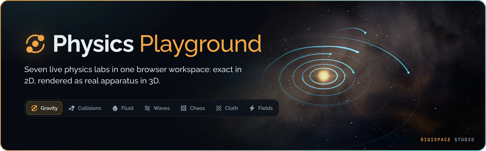
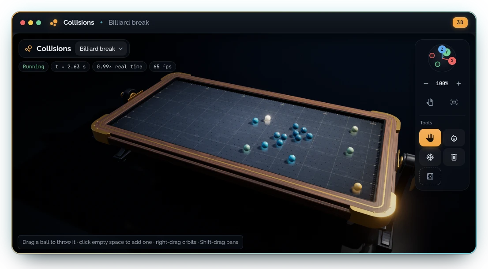
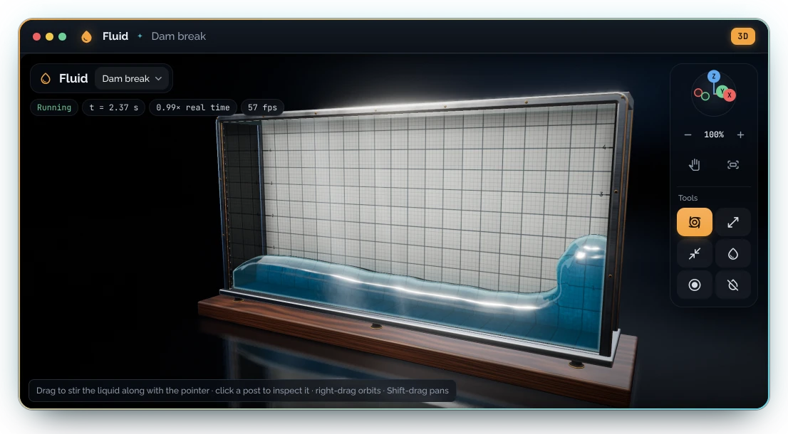
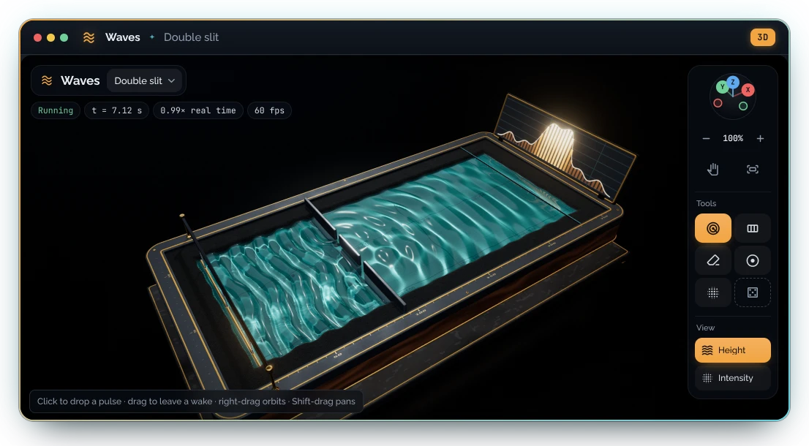
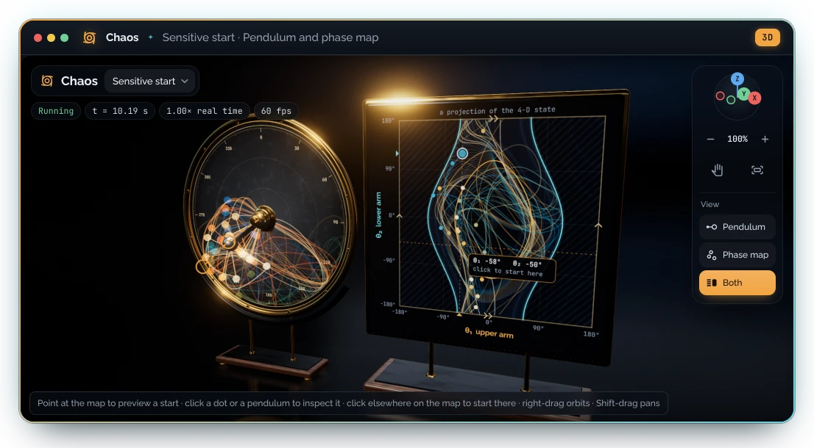
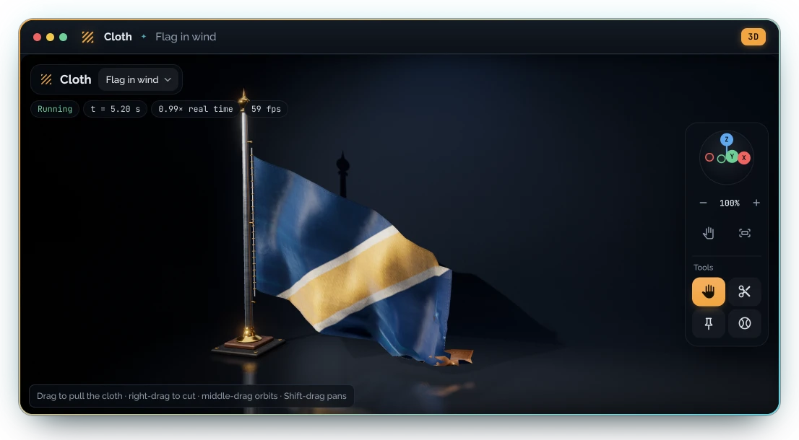
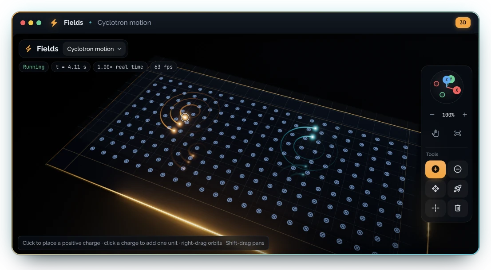

<!--
✒ Metadata
    - Title: Physics Playground Readme (digiSpace Edition - v2.4)
    - File Name: README.md
    - Relative Path: README.md
    - Artifact Type: docs
    - Version: 2.4.1
    - Date: 11/10/2026
    - Update: Tuesday, November 10, 2026
    - Author: Dennis 'dendogg' Smaltz
    - A.I. Acknowledgement: Anthropic - Claude Opus 5.5
    - Signature: ︻デ═─── ✦ ✦ ✦ | Aim Twice, Shoot Once!

✒ Changelog:
    - 2.4.1 (11/10/2026) [dendogg + Anthropic - Claude Opus 5.5] — Badges
      regrouped on Dennis's report that they broke up the flow: one row of
      four project badges under the tagline, the stack badges at the head of
      Stack, the coffee badge signing off Credits, and the Node.js badge
      dropped; release badge 2.4.1.
    - 2.4.0 (11/10/2026) [dendogg + Anthropic - Claude Opus 5.5] — Release
      2.4.0 on Dennis's brief for one interaction architecture: the stage
      rail, the deck's Telemetry, Inspect and Insights panes, selecting and
      inspecting objects in every lab that has them, Chaos's three views, and
      the Units section with its scales; V and U join the keyboard table.
    - 2.3.1 (11/10/2026) [dendogg + Anthropic - Claude Opus 5.5] — Release
      badge 2.3.1, now that the pictures it shows are in docs/media.
    - 2.3.0 (11/09/2026) [dendogg + Anthropic - Claude Opus 5.5] —
      Described the sectioned Controls page and the new Chaos phase view,
      with its gallery picture; release badge 2.3.0.
    - 2.2.0 (11/09/2026) [dendogg + Anthropic - Claude Opus 5.5] — Rebuilt
      the presentation on Dennis's direction: a banner, themed badges,
      framed screenshots of the workspace, a gallery of the labs and the
      2D and 3D pair, plus sections on deploying to GitHub Pages, the
      documentation set, and the digiSpace Studio credit.
    - 2.1.0 (11/06/2026) [dendogg + Anthropic - Claude Opus 5.5] —
      Documented the two modes and the graphics tiers; corrected the
      keyboard table and the Node.js floor.
    - 2.0.0 (11/05/2026) [dendogg + Anthropic - Claude Opus 5.5] — Created
      for v2.0 on Dennis's direction: documentation for the formal stack.

✒ Description:
    The front page of the project: what the playground is, what it looks
    like, how to run, use, develop and deploy it, and where the rest of
    the documentation lives.

✒ Key Features:
    - Banner, badges and a framed hero screenshot of the 3D workspace.
    - Lab gallery with framed 3D captures and a reference table of keys
      and scenes.
    - Side-by-side 2D and 3D capture of one moment.
    - Quick start, workspace, keyboard and capture reference.
    - Development commands, the GitHub Pages pipeline and browser support.
    - Documentation map and credits.

✒ Other Important Information:
    - Dependencies: docs/media/*.webp (tools/media.py) and shields.io for
      the badges
    - Compatible platforms: Any Markdown viewer; written for
      GitHub-flavoured Markdown, where the centred blocks and badge rows
      render as designed
---------
-->
<h1 align="center">
  
</h1>


---

<div align="center">

[![Live demo: open the lab][badge-demo]][demo]
[![Pages workflow status][badge-pages]][pages-workflow]
[![Release 2.4.1][badge-release]](CHANGELOG.md)
[![License: Apache 2.0][badge-license]](LICENSE)

**[Open the live lab][demo]** ✦ [Quick start](#quick-start) ✦
[The labs](#the-labs) ✦ [Deploying](#deploying-to-github-pages) ✦
[Documentation](#documentation) ✦ [Changelog](CHANGELOG.md)

**Seven live physics labs in one browser workspace.**<br>
Exact in 2D, rendered as real apparatus in 3D, and nothing to build.
</div>

---

Physics Playground is an interactive physics laboratory in the browser.
Seven live simulations share one workspace, one capture system and one set
of tools, and each can be seen in two modes: a flat 2D view, or a rendered
3D world where every lab is a physical apparatus. The project is plain ES
modules with no build step: open it through any static web server and it
runs.

- **Seven labs**, from N-body gravity to the Lorentz force, each with
  several scenes, live readouts and a page of the maths behind it.
- **Two modes, one simulation.** Press Z to flip between 2D and 3D in the
  middle of a run; tools, rewind and recordings work in both.
- **Instruments that explain themselves.** Plot any reading, inspect any
  object you click, and let the insights say why a setting misbehaves and
  offer the one-click fix.
- **Real-world units.** Metric, US customary or the simulation's own
  pixels: every reading, control and scale bar follows your choice.
- **Guided experiments** with live progress checks that measure the claim
  they make.
- **Capture everything**: rewind, WebM video, CSV datasets and exact saved
  states, all kept in a library.

## The labs

Gravity is the lab in the picture above. Here are the other six, each
captured in 3D straight from the playground.

<table>
  <tr>
    <td width="50%" valign="top">
      
      <br><b>2 · Collisions</b> ✦ Hard discs with restitution and contact
      friction on a slate air table in walnut and brass.
    </td>
    <td width="50%" valign="top">
      
      <br><b>3 · Fluid</b> ✦ Smoothed-particle hydrodynamics in a glass
      aquarium, with refraction and caustics.
    </td>
  </tr>
  <tr>
    <td width="50%" valign="top">
      
      <br><b>4 · Waves</b> ✦ The 2-D wave equation in a ripple tank, with a
      screen that graphs the fringes.
    </td>
    <td width="50%" valign="top">
      
      <br><b>5 · Chaos</b> ✦ Double pendulums started a hair apart, in three
      views: the pendulum, the map of their angles with the torus it wraps
      onto, or both side by side.
    </td>
  </tr>
  <tr>
    <td width="50%" valign="top">
      
      <br><b>6 · Cloth</b> ✦ Verlet cloth that stretches, tears and can be
      cut, woven and hung from a flagpole.
    </td>
    <td width="50%" valign="top">
      
      <br><b>7 · Fields</b> ✦ Point charges, potential and the Lorentz
      force, on a black glass bench lit by the potential.
    </td>
  </tr>
</table>

| Key | Lab | What it simulates | Scenes |
| --- | --- | --- | --- |
| 1 | Gravity | N-body Newtonian gravity in 3D, leapfrog integrator | Star system, Kepler ellipses, Binary star, Figure-eight, Accretion disk, Tilted orbits, Empty sky |
| 2 | Collisions | Hard discs with restitution and contact friction | Ideal gas, Gravity pile, Billiard break, Brownian motion |
| 3 | Fluid | Smoothed-particle hydrodynamics with a GPU liquid surface | Dam break, Obstacle course, Droplet splash, Twin columns, Zero-g collision |
| 4 | Waves | The 2-D wave equation on a grid | Open tank, Double slit, Single slit, Two sources, Phased array, Glass lens, Moving source |
| 5 | Chaos | Double pendulums started a hair apart; Pendulum, Phase map and Both views of their angles on the energy landscape | Sensitive start, Near inverted, Small swing, Normal mode |
| 6 | Cloth | Verlet cloth that stretches, tears and can be cut | Curtain, Hammock, Flag in wind, Fragile net |
| 7 | Fields | Point charges, potential, field lines and the Lorentz force | Dipole, Quadrupole, Parallel plates, Cyclotron motion, E × B drift, Grad-B drift |

Every lab has live readouts, diagnostics that explain extreme settings
and offer one-click fixes, a page of the maths behind it, and two or
three guided experiments with live progress checks. All but Cloth also
keep a running chart.

## Quick start

The fastest way in is the **[live lab][demo]**, served by GitHub Pages.

To run it yourself: the modules load over HTTP only (a `file://` page
cannot import them). With Node.js 20.19 or later:

```bash
npm run dev
```

Then open <http://localhost:5173/>. Add a lab name to the address to open
it directly, for example <http://localhost:5173/#fields>. Any other static
server works too, for example `python -m http.server 5173`.

## Two modes: 2D and 3D


The **2D | 3D** switch in the top bar, or the **Z** key, changes the whole
workspace. Your choice is remembered.

- **2D** is the flat view of each lab: clear, fast and exact.
- **3D** stands each lab in a studio as a physical apparatus, lit with real
  shadows and reflections. The simulation is the same in both, so a run
  carries on when you switch, and every tool, rewind, recording and saved
  state works in either.

If 3D cannot run, because the browser lacks WebGL 2 or three.js could not
load, the workspace stays in 2D and says why.

| Lab | In 3D |
| --- | --- |
| Gravity | Open space: a nebula, plasma stars, and rocky, ocean and ringed gas worlds |
| Collisions | A slate air table in walnut and brass, which tilts when gravity is on |
| Fluid | A glass aquarium of real-looking liquid, with refraction and caustics |
| Waves | A walnut ripple tank with projected caustics and a screen graphing the fringes |
| Chaos | A slate dial in a brass bezel; the phase screen beside it, or beside a glass torus |
| Cloth | Woven fabric on a gantry, hammock posts, a flagpole or a net rail |
| Fields | A black glass bench with the potential as a relief of light |

No model or texture is downloaded: the lighting, wood, stone, brushed metal
and planets are all generated in the browser.

### Graphics tiers

The **Graphics** button beside the switch sets how much the 3D mode asks of
your machine.

| Tier | Resolution | Antialiasing | Shadows | Reflections | Meant for |
| --- | --- | --- | --- | --- | --- |
| Ultra | up to 2× | 4× | 4096 | sharp | Strong dedicated GPUs |
| High | up to 1.5× | 4× | 2048 | soft | Dedicated GPUs, recent Apple silicon |
| Medium | up to 1.25× | 2× | 1536 | softer | Recent integrated graphics |
| Low | 1× | none | 1024 | none | Older laptops and phones |
| Lite | 0.75× | none | none | none | Software rendering |

**Auto**, the default, starts from your GPU and adjusts to the frame rate. It
steps down when frames run long and back up when there is room. If a step
down buys nothing, it undoes it and stops adapting, because the limit is then
the solver or the display rather than the GPU. The Insights pane says when
Auto changes tier, and offers a cheaper tier when a fixed one runs slowly.

## Using the workspace

The workspace is one large stage, an Instruments deck beneath it and a
full-height Inspector beside them.

- **Stage**: the simulation. The lab's name in the top left holds the scene
  dropdown; loading a scene restarts the run.
- **Stage rail**: hangs from the top-right corner, in the same place in every
  lab. **Camera** comes first (the axis ball in 3D, zoom, pan and frame), then
  what belongs to this lab: its **Tools** (what a click does), its **View**
  (what the stage shows, in Chaos and Waves) and its scene extras, such as
  Gravity's Follow. Tools and views are radio groups: arrow keys move within
  one, and a view never restarts or rewinds the run.
- **Player bar**: play, step, reset, speed, the rewind timeline, and the video,
  data and save buttons.
- **Instruments**: three panes over one header.
  - **Telemetry**: every reading as a live gauge beside the lab's chart; the
    first ones lead with larger figures. Click a gauge to plot it, up to four
    at once, each in its own lane on one time axis. Hover the plot to read any
    moment, click or drag along it to rewind to that moment (as far back as
    the rewind history reaches), and use the wheel to zoom the time window.
  - **Inspect**: the object you clicked on the stage, with its live figures,
    read-only. A figure's chart button plots it under Telemetry beside the
    readings. Settings stay in Controls; the card offers only actions on the
    object itself, such as remove or follow.
  - **Insights**: what the run is doing and why a setting misbehaves, each
    with its fix, beside the frame-timing strip. Its tab shows the count, and
    the top alert and its fix stay in the header whichever pane is open.

  The button at the right of the header steps the deck through compact,
  standard and tall, and the grip on its top edge drags it to any height
  (arrow keys on the grip step it; Enter restores the standard height).
- **Inspector**: the lab's formula above five tabs: Controls, Experiments,
  Guide, Math and Library. Controls opens with the lab's quick actions, then
  its settings in sections such as Setup, Physics and Display. Fold a
  section away, or use its **Reset** to return it to the scene's values; a
  section whose changes restart the run says so once. A disabled control
  says why underneath.
- **Selecting things**: click a body in Gravity, a ball in Collisions (with
  Grab), a particle in Fields (with Move), a post in Fluid (with any tool but
  Obstacle), a source in Waves, or a pendulum or a dot on the map in Chaos.
  Inspect opens on its own and returns to where you were when you clear the
  selection. Gravity shows a rendered portrait of the body and its orbit:
  distance, period, eccentricity and inclination.

### Units

The **Units** button in the top bar, or **U**, picks what every reading,
control, inspected figure and scale bar is shown in. The simulations always
compute in their own units, so switching never changes a run; typed values
are read in the units shown.

| System | Shows | Scale |
| --- | --- | --- |
| Metric (default) | metres, m/s, m/s², J/kg | Fluid, Collisions, Cloth and Fields: one pixel is 1.09 cm, so 900 px/s² of gravity is 9.81 m/s². Waves: one cell is 4 mm, a ripple-tank scale. Chaos computes in metres already. Gravity is astronomical: AU, km/s, days and years, solar, Jupiter and Earth masses. |
| US customary | feet, ft/s, ft/s², ft²/s² | The same scales, in feet and inches (miles per second in Gravity). |
| Simulation | px, px/s, cells | The labs' own units, exactly as computed. |

The menu states the current lab's scale. Datasets keep the lab's own units
and record that scale beside them. Masses, energies and charges in
Collisions and Fields stay in simulation units, since those labs define them
for the computation rather than from real materials.

Press **F** to give the stage the whole window and **Shift+B** to hide the
Instruments. The layout reflows to one column below 1180 px.

### Mouse and touch

- Wheel zooms at the cursor. Middle-drag, right-drag or Space-drag pans.
- In 3D mode, right-drag orbits and Shift-drag pans. Dragging the empty space
  around the apparatus orbits too, and so does the axis ball; click an axis to
  look along it. Z on the ball looks straight at the simulation plane. In
  Cloth the right button is a tool, so middle-drag orbits.
- Zooming in follows the cursor and zooming back out returns to the home
  view, so you can always find your way back.
- On touch screens, pinch zooms and two fingers pan.

### Keyboard

| Keys | Action |
| --- | --- |
| Space | Play or pause (hold and drag to pan) |
| . and , | Step forward one frame, step back through the rewind history |
| R | Reset the scene |
| 1–7 | Switch lab |
| Z | Switch between 2D and 3D |
| Letters | Pick a tool (shown on each tool button) |
| V | Next view, in Chaos and Waves |
| U | Units menu |
| + − 0 | Zoom in, zoom out, frame the view |
| Arrow keys | Pan, or orbit in 3D mode |
| [ and ] | Halve or double the speed |
| M and D | Record a video clip, record a dataset |
| F and Shift+B | Focus the stage, hide the Instruments |
| ? | Keyboard reference |

## Capturing runs

- **Rewind**: drag the timeline back to replay recent history. Playing
  from the past starts a new branch.
- **Video**: records the stage as a WebM clip.
- **Data**: records a CSV dataset of the lab's quantities, plus per-body
  tracks where the lab has them.
- **Save state**: stores the exact state of the scene to restore later.

Everything saved appears in the **Library** page of the notebook. The
Library tab shows how many items are saved and marks new ones. When the
page runs as a published artifact, the library syncs with the artifact;
otherwise it lives in this browser.

## Stack

<div align="center">

[![ES modules, no build step][badge-esm]](ARCHITECTURE.md#principles)
[![three.js 0.187.0][badge-three]](vendor/VENDOR.md)
[![KaTeX 0.19.1][badge-katex]](vendor/VENDOR.md)
[![Browser tests: Playwright][badge-tests]](#development)

</div>

| Layer | Choice | Why |
| --- | --- | --- |
| Code | Native ES modules, no bundler | Nothing to build; every file is the file that runs |
| Icons | Material Symbols Rounded (Google Fonts) | One cohesive icon family, subset to the glyphs used |
| Maths | KaTeX 0.19.1 | Real typesetting for formula cards; module from jsDelivr, CSS and fonts vendored |
| 3D | three.js 0.187.0 | The whole 3D mode, one renderer shared by every lab; loaded only when 3D is first used |
| 2D fluid surface | Hand-written WebGL | A small, fast shader for the flat view |
| Tooling | Node.js scripts, ESLint, Playwright tests | Dev server, checks, Pages staging and browser tests with no runtime dependencies |
| Hosting | GitHub Pages | Static files served as they are; see [Deploying](#deploying-to-github-pages) |

The third-party pieces and their licences are listed in
[vendor/VENDOR.md](vendor/VENDOR.md). If a CDN cannot be reached, the
playground keeps working: formulas fall back to their TeX source, icon
names hide, and the workspace says 3D is unavailable and stays in 2D.

## Project layout

```text
index.html            page, tiles, colophon, CDN links and import map
css/                  tokens, icons, workspace, controls, stage, tiles, library, responsive
js/main.js            boot sequence
js/core/              pure helpers: DOM, colour, charts, drawing, maths, icons, TeX, graphics tiers, units
js/render/            the 2D fluid surface shader
js/render/world/      the 3D mode: engine, studio, materials, shapes, ribbons
js/render/world/scenes/  one three.js scene per lab
js/labs/              one module per lab, the plane camera, the gravity camera, the experiments curriculum, the registry
js/shell/             workspace: state, panel, rail, deck, camera, stage input, loop, modes, units, capture, library, experiments
tools/                dev server, project checker, Pages stager, README media capture
tests/                Playwright browser suites and their runner
vendor/katex/         KaTeX stylesheet, fonts and licence
docs/media/           README banner and screenshots, with their manifest
.github/workflows/    the Pages verify-and-deploy workflow
.nojekyll             tells GitHub Pages to serve files as they are
```

[ARCHITECTURE.md](ARCHITECTURE.md) explains how the pieces fit together
and how to add a lab, a tool or an experiment.

## Development

| Command | What it does |
| --- | --- |
| `npm run dev` | Serve the project on port 5173 (`node tools/serve.mjs 8080` for another port) |
| `npm run lint` | ESLint over the modules and tools |
| `npm run check` | Headers, changelog bounds, icon subset and module syntax |
| `npm run site` | Stage the Pages site in `_site/` and prove every reference resolves |
| `npm run verify` | Lint, check and site: the same gate the Pages workflow runs |
| `npm test` | Run every browser suite against the running dev server |
| `npm run media` | Capture the README banner and screenshots from the running dev server; `npm run media -- --headed` renders on the GPU and is much faster |

Install the dev tools with `npm ci`, which installs exactly the versions in
`package-lock.json`. The browser suites and the media capture need Python 3
with Playwright (`pip install playwright` and `playwright install
chromium`). Start the dev server first, then run `npm test`. Set `PP_URL`
to test another address and `PP_SHOTS` to choose where screenshots go.

## Deploying to GitHub Pages

The [live lab][demo] is this repository served by GitHub Pages. There is
nothing to build: Pages serves the same files that run locally, and three
pieces keep that dependable.

- **`.nojekyll`** tells Pages to publish files as they are. Without it, a
  branch deploy runs the whole repository through Jekyll first.
- **`npm run site`** stages exactly what the browser loads (`index.html`,
  `LICENSE`, `css/`, `js/` and `vendor/katex/`) into `_site/`, then follows
  every reference from `index.html` through the stylesheets and modules. It
  fails on a missing file, a letter-case slip, a root-absolute path (which
  breaks under the `/physics-playground/` project path), an unpinned import
  map entry, or a CDN that [vendor/VENDOR.md](vendor/VENDOR.md) does not
  list.
- **[`.github/workflows/pages.yml`](.github/workflows/pages.yml)** runs
  `npm ci`, lint, check and site on every push and pull request. On `main`
  it deploys the verified `_site/` when the repository's Pages source is
  **GitHub Actions**, and its run summary says what it did.

| Pages source (Settings → Pages) | What publishes a push to `main` | What reaches the site |
| --- | --- | --- |
| Deploy from a branch | GitHub's own *pages build and deployment* run; the Pages workflow verifies alongside it | The whole branch, as it is |
| GitHub Actions (recommended) | The Pages workflow, only after every check passes | Only `_site/`: no tests, tools or docs |

To switch, open **Settings → Pages → Build and deployment** and set
**Source** to **GitHub Actions**. The next push to `main`, or **Run
workflow** on the Pages workflow in the Actions tab, deploys. To preview
the staged site, run `npm run site` and serve the folder:

```bash
python -m http.server 8080 --directory _site
```

## Browser support

Chrome and Edge 105+, Firefox 110+ and Safari 16.4+: the page needs ES
modules, import maps and container queries. The 2D fluid surface uses WebGL 2
or WebGL 1 and draws as particles without either. The 3D mode needs WebGL 2;
without it the workspace says so and stays in 2D.

## Documentation

| Document | What it covers |
| --- | --- |
| [ARCHITECTURE.md](ARCHITECTURE.md) | Layers, boot order, the frame loop, the lab contract, the 3D mode, deployment, and recipes for extending the playground |
| [CHANGELOG.md](CHANGELOG.md) | Every release in full, newest first |
| [vendor/VENDOR.md](vendor/VENDOR.md) | Third-party code: versions, sources, licences and what happens offline |
| [package.metadata.md](package.metadata.md) | What `package.json` declares, and every npm script |
| [docs/media/MANIFEST.md](docs/media/MANIFEST.md) | The README pictures: what each shows, where it came from, how to recapture it |

## Credits and license

Brought to you by **digiSpace Studio**, and made with epic amounts of
coffee by Dennis 'dendogg' Smaltz.

Physics Playground is licensed under the Apache License 2.0: see
[LICENSE](LICENSE). Third-party licences are listed in
[vendor/VENDOR.md](vendor/VENDOR.md).

<div align="center">

[![Brewed with epic amounts of coffee][badge-coffee]](#credits-and-license)

</div>

<p align="center"><sub>︻デ═─── ✦ ✦ ✦ | Aim Twice, Shoot Once!</sub></p>

[demo]: https://dnoice.github.io/physics-playground/
[pages-workflow]: https://github.com/dnoice/physics-playground/actions/workflows/pages.yml
[badge-demo]: https://img.shields.io/badge/live_demo-open_the_lab-f2a541?style=flat-square&labelColor=0c1118&logo=githubpages&logoColor=f2a541
[badge-pages]: https://img.shields.io/github/actions/workflow/status/dnoice/physics-playground/pages.yml?branch=main&style=flat-square&label=pages&labelColor=0c1118&logo=githubactions&logoColor=5fd0df
[badge-release]: https://img.shields.io/badge/release-v2.4.1-5fd0df?style=flat-square&labelColor=0c1118
[badge-license]: https://img.shields.io/badge/license-Apache_2.0-5fd0df?style=flat-square&labelColor=0c1118&logo=apache&logoColor=5fd0df
[badge-esm]: https://img.shields.io/badge/ES_modules-no_build_step-232c39?style=flat-square&labelColor=0c1118&logo=javascript&logoColor=f2a541
[badge-three]: https://img.shields.io/badge/three.js-0.187.0-232c39?style=flat-square&labelColor=0c1118&logo=threedotjs&logoColor=5fd0df
[badge-katex]: https://img.shields.io/badge/KaTeX-0.19.1-232c39?style=flat-square&labelColor=0c1118&logo=latex&logoColor=5fd0df
[badge-tests]: https://img.shields.io/badge/tests-Playwright-232c39?style=flat-square&labelColor=0c1118&logo=playwright&logoColor=6fcf97
[badge-coffee]: https://img.shields.io/badge/brewed_with-epic_amounts_of_coffee-f2a541?style=flat-square&labelColor=0c1118
